<a href="https://just-sampath.in">
  <picture>
    <source media="(prefers-color-scheme: dark)" srcset="assets/header-dark.svg">
    
  </picture>
</a>

I'm a full stack and applied AI engineer who keeps drifting toward the backend: APIs, queues, data,
and how it all holds up under load. I like taking new tech apart to see how it behaves, usually on a weekend,
usually in one of the repos below. I keep starting new ones, so that list will probably be out of
date soon 😅

My take on AI systems is plain system design: **clear boundaries**, **bounded retries**, **a budget
for every request**, **observability from day one**, and **measurements over vibes**. The budget
covers time as well as cost, because a right answer that shows up too late is still a bad answer.
None of it works if you can't see it, so every step gets traced: where the time went, what it cost,
and whether the answer was any good. The sketch above shows the same idea.

### Things I'm poking at

<a href="https://github.com/just-sampath/adaptive-deterministic-rag"><picture><source media="(prefers-color-scheme: dark)" srcset="assets/card-adaptive-deterministic-rag-dark.svg"></picture></a>
<a href="https://github.com/just-sampath/ats-resume-maker"><picture><source media="(prefers-color-scheme: dark)" srcset="assets/card-ats-resume-maker-dark.svg"></picture></a>
<a href="https://github.com/just-sampath/leetcode-guider"><picture><source media="(prefers-color-scheme: dark)" srcset="assets/card-leetcode-guider-dark.svg"></picture></a>
<a href="https://github.com/just-sampath/get-GO-ing"><picture><source media="(prefers-color-scheme: dark)" srcset="assets/card-get-GO-ing-dark.svg"></picture></a>

### Toolbox

<picture>
  <source media="(prefers-color-scheme: dark)" srcset="assets/toolbox-dark.svg">
  
</picture>

Work history and résumé live at <a href="https://just-sampath.in">just-sampath.in</a> · <a href="https://linkedin.com/in/just-sampath">LinkedIn</a>
